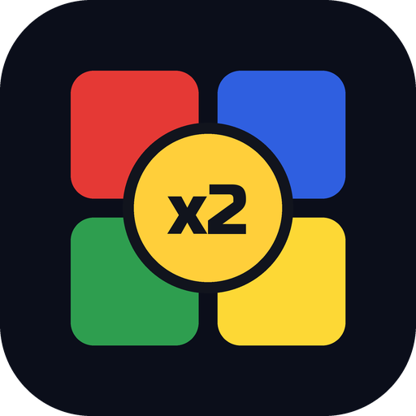
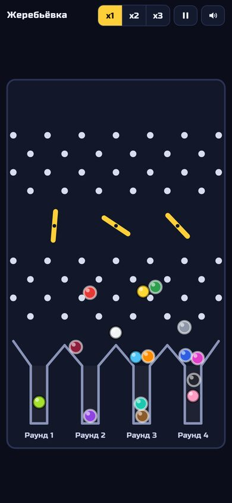
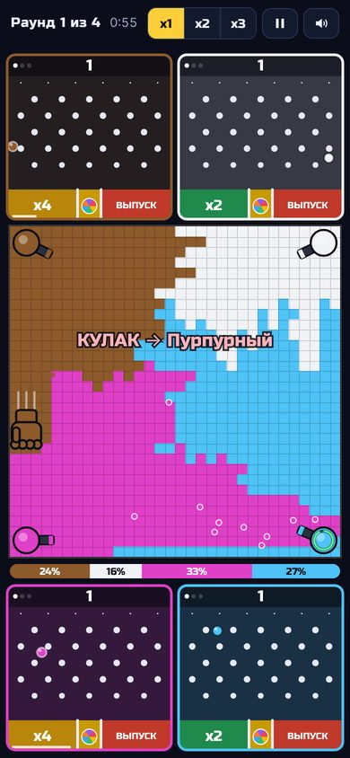
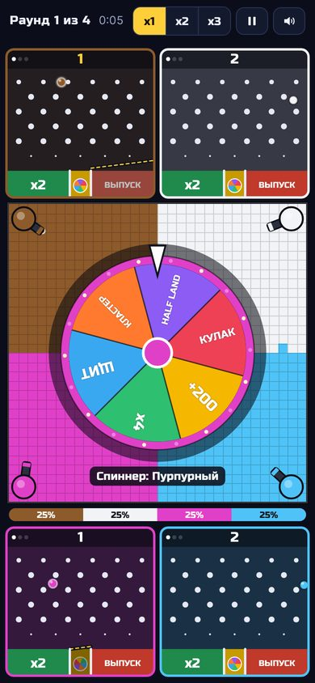
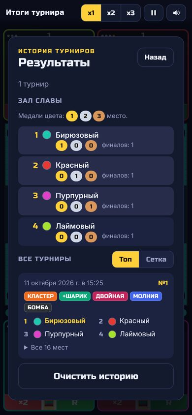
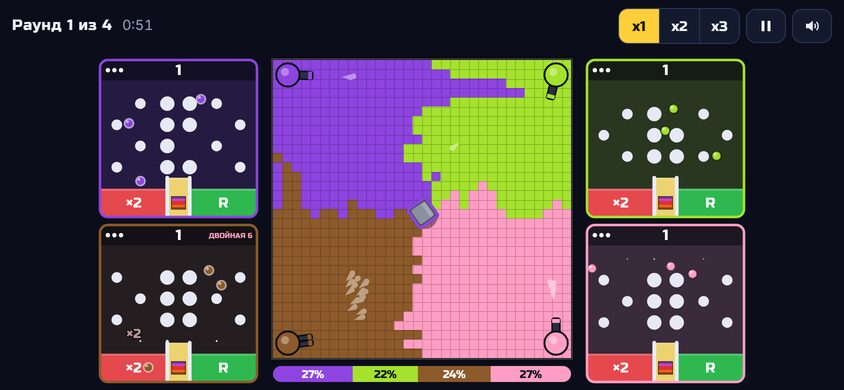

# Multiply or Release — турнир со спиннером (Android)

Симулятор-турнир для 16 цветов в жанре «Multiply or Release». Шарики падают
сквозь поднимающиеся препятствия в лунки **x2**, **спиннер** и **выпуск**, а
пушки в углах главного поля захватывают территорию. Выигрывает цвет, который
остался на поле один.

| Жеребьёвка | Бой | Рулетка | История |
|---|---|---|---|
|  |  |  |  |



## Установка на телефон

1. Скачайте на телефон [`release/multiply-or-release.apk`](release/multiply-or-release.apk)
   (≈0,2 МБ, Android 7.0 и новее, интернет не нужен).
2. Откройте файл и разрешите установку из этого источника.

APK подписан отладочным (debug) ключом. Для публикации в Google Play
пересоберите его со своим ключом.

## Как играть

- **Начать турнир** → жеребьёвка (16 шариков падают в 4 колбы) → 4 раунда → финал → топ из 16 мест.
- В каждом турнире на колесе спиннера 5 случайных бонусов из 15; они видны на экране сетки.
- **История турниров** (в меню и на экране итогов): дата, места, бонусы и зал славы по цветам.
- Итоги турнира и историю можно смотреть в двух видах: **Топ** (пьедестал и 16 мест) или **Сетка** (турнирное дерево с короной чемпиона).
- **x1 / x2 / x3** — скорость времени, кнопка паузы, кнопка звука.
- Кнопка «Назад» на Android ставит паузу или закрывает историю, из главного меню закрывает игру.
- На компьютере: клавиши `1` `2` `3` меняют скорость, `пробел` ставит паузу.

Полные правила, включая то, что пришлось додумать вместо видео, описаны в
[GAME_DESIGN.md](GAME_DESIGN.md).

## Сборка

**Android Studio.** Откройте папку `android/` (File → Open) и нажмите Run.
Из терминала, если установлен Android SDK:

```bash
cd android
./gradlew assembleRelease   # app/build/outputs/apk/release/app-release.apk
```

**Без Android SDK.** Скрипт `tools/build_apk.sh` собирает тот же APK. Нужны
только JDK 11+, `curl`, `unzip` и `zip`. Скрипт сам скачивает aapt2 и ресурсы
фреймворка (из apktool), dx (Maven Central) и uber-apk-signer:

```bash
tools/build_apk.sh                  # → release/multiply-or-release.apk
```

**В браузере.** Игра написана на HTML5 Canvas, поэтому её можно открыть прямо
в браузере: `android/app/src/main/assets/index.html`. Параметры адреса:
`?seed=123` (повторить тот же турнир), `?speed=3`, `?autostart=1`.

## Настройка баланса

Все числа собраны в начале `android/app/src/main/assets/js/battle.js`: размер
поля, прочность пушки, начало и шаг овертайма, число шариков, раскладка и
скорость препятствий (`PEG_PATTERN`, `DIV_R`), параметры всех 15 бонусов
(`BONUSES` и константы над ними), размер колеса (`WHEEL_SIZE`).

## Устройство проекта

```
multiply-or-release/
├── release/multiply-or-release.apk    готовый APK
├── android/                           Android-проект (Gradle, Java)
│   └── app/src/main/
│       ├── java/.../MainActivity.java полноэкранный WebView, кнопка «Назад», экран не гаснет
│       └── assets/                    сама игра
│           ├── index.html             интерфейс: меню, сетка, итоги, история, панель скорости
│           └── js/
│               ├── core.js            цвета, RNG, звук (WebAudio)
│               ├── physics.js         столкновения шариков
│               ├── drawscene.js       жеребьёвка
│               ├── battle.js          бой: поле, пушки, боковые поля, рулетка, 15 бонусов
│               └── main.js            турнир, история, интерфейс, игровой цикл
├── tools/
│   ├── build_apk.sh                   сборка APK без Android SDK
│   ├── android-stubs/                 заглушки API для этой сборки (в APK не попадают)
│   └── make_icons.py                  генерация иконок
├── GAME_DESIGN.md                     дополненное ТЗ
└── docs/                              скриншоты
```

Шрифт Russo One распространяется по лицензии SIL Open Font License
(`assets/fonts/OFL.txt`).
