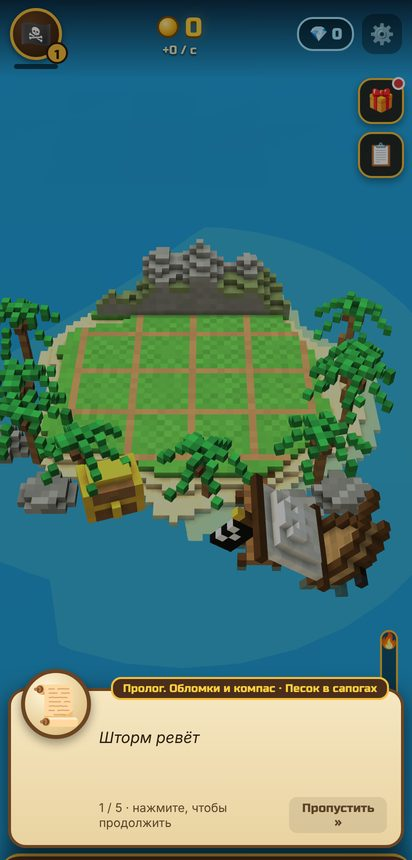
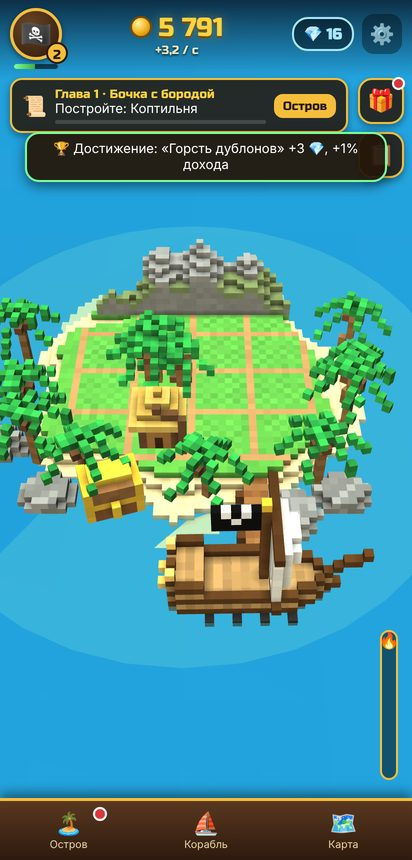
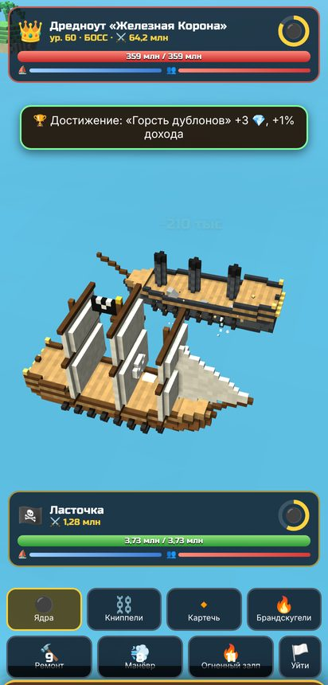
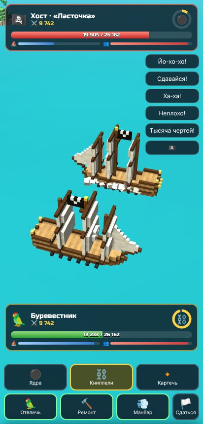
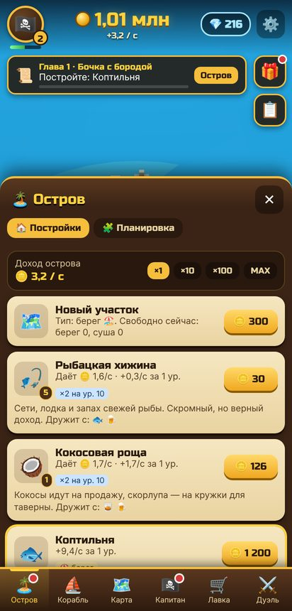
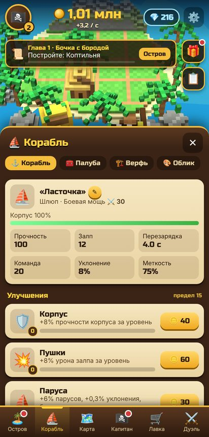
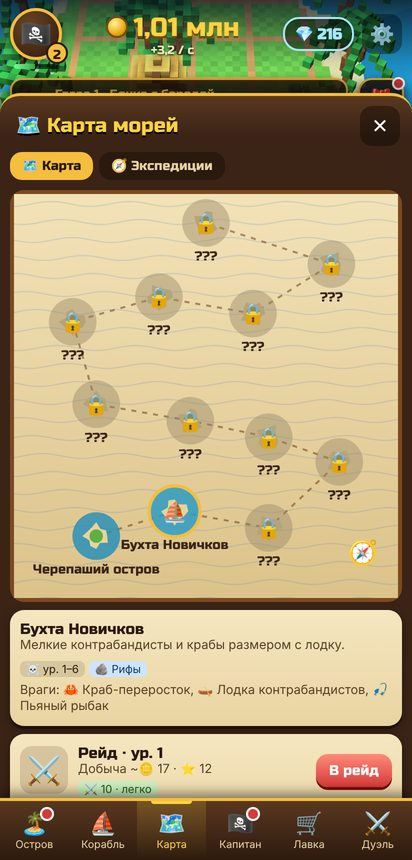
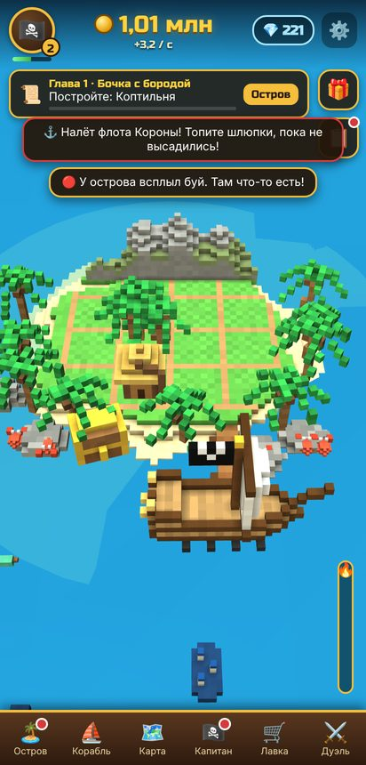

# Воксельные Корсары

Воксельная пиратская игра для Android: кликер + стратегия + морские бои + длинный сюжет
и дуэли 1 на 1 по Wi-Fi.

<p>
   
</p>
<p>
   
</p>

**Готовый APK:** [`release/voxel-corsairs.apk`](release/voxel-corsairs.apk) (Android 7.0+, ~0.5 МБ).
Установка: скачать файл на телефон → открыть → разрешить установку из этого источника.

## Что внутри

- **Кликер.** Тапы по острову приносят дублоны; серия тапов разжигает «Золотую лихорадку» (×5 на 10 с),
  есть критические тапы и шанс найти жемчуг.
- **Автоматизация.** 16 построек на острове (хижина → обсерватория Бездны) приносят золото сами,
  даже когда игра закрыта. Модуль «Юнга-тапальщик» на палубе тапает за вас.
- **Стратегия.** Участки острова двух типов (берег/суша), бонусы соседства пар построек
  (хижина+коптильня, винокурня+тростник, рудник+монетный двор…), ограниченные слоты палубы корабля.
- **Корабли.** 7 классов (шлюп → бригантина → фрегат → галеон → линкор → «Летучий Голландец» → «Левиафан»),
  4 улучшения (корпус, пушки, паруса, команда), 10 модулей палубы, скины парусов/флагов/корпуса.
- **Морские бои.** Бортовые залпы в реальном времени: тапы ускоряют перезарядку, 4 типа снарядов
  (ядра, книппели, картечь, брандскугели), абордаж, способности офицеров, боссы с особыми атаками
  (хватка кракена, молнии, бесплотность, щиты). Опасности в пути: рифы, шторм, туман, водоворот, льды.
- **Сюжет.** Пролог + 10 глав, 65 миссий с диалогами: поиски капитана Кремня, 7 осколков Сердца Моря,
  Адмирал Ворон, финальный выбор с разными бонусами. 20 «Записок Кремня» в бутылках.
- **Прокачка капитана.** Уровни, 18 талантов в 3 ветках (Делец, Канонир, Мореход), 7 офицеров.
- **Авто-события.** Золотой попугай, бутылки с записками и картами, крабы, торговые суда, налёты флота,
  шторма, затонувшие сундуки, корабли-призраки ночью, поиск клада. Смена дня и ночи.
- **Экспедиции, задания дня, награды за вход, 42 достижения, «Легенда»** (престиж со Славой)
  и бесконечный режим «Бездонные воды» после финала.
- **Лавка** за жемчуг и дублоны: ускорители, сундуки, вечные бонусы, скины. Реальных платежей нет.
- **Дуэль 1 на 1.** Два телефона в одной Wi-Fi сети (или один раздаёт точку доступа): «Создать дуэль» /
  «Найти дуэль» (или вход по IP). Режимы «Равный бой» и «Свои корабли», рейтинг Эло, эмоции в бою.
  Есть тренировочная дуэль с ботом. Для игры через интернет — **онлайн-режим по коду комнаты**
  через свой маленький relay-сервер (см. ниже).

## Онлайн-дуэли через интернет

Игроки в разных сетях соединяются через relay-сервер — он только пересылает сообщения, сам бой
считается на телефоне создателя комнаты. Сервер — один файл без зависимостей (нужен Node.js 14+):

```bash
node tools/relay_server.js 8080        # на любом VPS/компьютере с открытым портом 8080
```

В игре: «Дуэль» → «Онлайн-дуэль» → ✎ → адрес `ws://<IP-или-домен>:8080` (или `wss://…` за HTTPS-прокси).
Один игрок нажимает «Создать комнату» и называет другу 4-значный код, второй — «Войти по коду».

## Для тестировщика

В ⚙️ Настройки → **Режим тестировщика**: ускорение времени ×5/×20, «+1 ч дохода», «+×10 золота»,
«+100 💎», «+5 уровней», «Пропустить миссию», «Событие». Там же экспорт/импорт сохранения.

Сборка и тесты:

```bash
tools/build_apk.sh                      # APK без Android SDK (JDK + curl + unzip + zip)
node tools/sim_economy.js 40 0 4        # симуляция баланса: когда бот проходит главы
npx http-server -p 8766 -c-1 .          # затем:
node tools/test_smoke.js                # UI, пролог, все вкладки, события, бой, дуэль с ботом
node tools/test_duel.js                 # две вкладки = два телефона: лобби, синхронный бой, рейтинг
node tools/relay_server.js 8090 & node tools/test_duel.js "" "" --online ws://localhost:8090   # то же через relay
node tools/test_story.js                # весь сюжет 65/65, бесконечный режим, Легенда, офлайн-доход
```

С установленным Android SDK можно собрать и через Gradle: `cd android && ./gradlew assembleRelease`.

## Устройство проекта

```
android/                  Gradle-проект (WebView-оболочка)
  app/src/main/java/…     MainActivity (полноэкранный WebView) и GameBridge (LAN-дуэли, вибрация, бэкап сохранения)
  app/src/main/assets/    сама игра: index.html, css/, js/, lib/three.min.js, fonts/
tools/                    сборка APK, иконки, симуляция баланса, автотесты, просмотрщик моделей
docs/                     скриншоты и иконка
release/                  собранный APK
GAME_DESIGN.md            сюжет, экономика, формулы, протокол дуэли
```

Ключевые модули JS: `data.js` и `story.js` (весь контент), `state.js` (экономика и формулы),
`combat.js` (общая боевая система для PvE, бота и PvP), `voxel.js`/`models.js` (воксельный меш и
процедурные модели), `scene.js` (three.js), `net.js`/`duel.js` (сеть и протокол дуэли).

## Лицензии сторонних частей

- three.js r149 — MIT (`assets/lib/three.LICENSE.txt`)
- Шрифт Russo One — SIL Open Font License (`assets/fonts/OFL.txt`)
- Мелодия «Drunken Sailor» — народная (общественное достояние), синтезируется в коде
